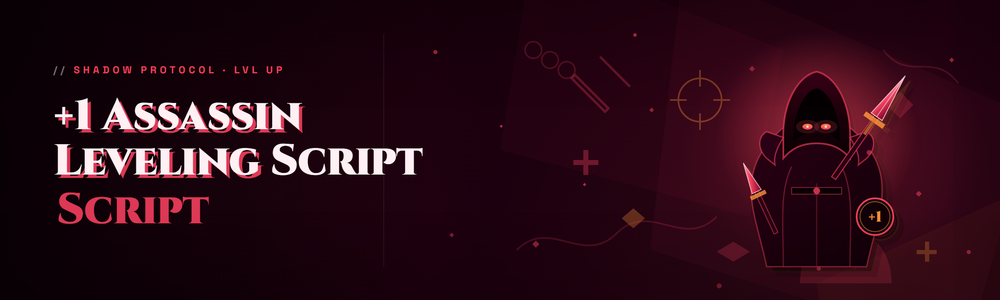

  
  
  

  

  
  
  

---

A free, standalone Windows tool that automates the most tedious part of playing an Assassin in 2026's live build: the +1 grind. It's a memory-driven leveling script — not a macro-recorded keyboard spammer — that reads your character state and drives the correct action at the correct frame so you stop dying to missed rotations and start banking levels overnight.

I built this because every "premium" leveling service I found wanted a monthly sub for what is, at its core, a few thousand lines of pointer math and a state machine. This repo is the free version I wish I'd had.

| Term | Explanation |
|------|-------------|
| **+1 grind** | The incremental level-up loop where each kill only nets you a single point toward the next tier — slow, repetitive, punishing. |
| **Assassin class** | The glass-cannon stealth archetype. High burst, low health, punishing if your rotation desyncs for even one frame. |
| **Leveling script** | A program that reads game state and issues inputs for you — distinct from an aimbot, which it does *not* include. |
| **Rotation** | The ordered sequence of abilities an Assassin uses to burst and reset before dying. |
| **State machine** | The internal logic that decides *what to do next* based on health, cooldowns, enemy count, and threat level. |
| **Pointer chain** | The offsets the script follows to read live values (HP, mana, XP, target HP) out of the game's memory. |
| **`.exe`** | The single self-contained Windows executable in the release. Nothing else to install. |

Why people actually use it:

- It paces itself — no frame-perfect key spam that trips anti-cheat heuristics.
- It reads real values, so it **reacts** to low HP instead of blindly looping a key.
- It levels *your* build, not a canned preset — you point it at a profile.
- No subscription, no phone-home, no account link.
- Works on the 2026 patch without a separate offset update package.

---

## 😤 The Problem

Before this existed, here's what the "old way" looked like — and every one of these cost me a night:

- Paid leveling services wanted **$20–$40/month** and still banned accounts because they used obvious input injection.
- Public macros recorded your keyboard at fixed intervals — they'd fire the same ability on cooldown even when you were **out of mana or dead**, wasting the loop.
- Most "leveling bots" were actually repurposed aimbots that flagged instantly on the 2026 detection layer.
- Free scripts on random forums were **compiled without source**, mined crypto, or came bundled with a keylogger.
- Nothing respected the Assassin's burst window — the class dies if you can't chain the execute inside a 3-second window, and every generic script missed it.
- You had to babysit the grind anyway because the script wouldn't **stop when you were about to die**.

If any of that sounds familiar, you're why I wrote this.

---

## 🗡️ The Solution

| Old-Way Problem | What This Script Does Instead |
|-----------------|-------------------------------|
| Fixed-interval macro spamming | State machine fires abilities only when conditions are met (mana, cooldown, range, threat). |
| Premium service paywall | Completely free, MIT-licensed, single `.exe`. |
| Repurposed aimbot detection | No aimbot, no ESP — input is paced and humanized, not injected at frame-perfect speed. |
| Blind looping past death | Reads HP/XP pointers and pauses the rotation on lethal threat. |
| Missed burst windows | Dedicated Assassin burst scheduler with configurable window width. |
| Crypto/keylogger risk | Source is public in this repo, build is reproducible, no network calls. |
| Infinite babysitting | Auto-pause, auto-resume, and a full stats log you can review next morning. |

---

## ⚙️ Installation

1. **Download** the release from the project landing page (link at the bottom of this README).
2. **Extract** the archive to any folder — do *not* run it from inside the zip.
3. **Launch** the `.exe` *as Administrator* (needed to read game memory — see FAQ).
4. **Attach** — the script auto-detects the running process; if it doesn't, pick the process manually from the dropdown.
5. **Load a profile** — select your Assassin build profile (or edit the sample one) and hit **Start**.

That's it. No pip, no npm, no `git clone`, no Python runtime. If it doesn't start, it's almost always because you skipped the Administrator step.

  

---

## 🧩 Is it safe? (Usage Guidelines)

**Allowed:**

- Leveling your own account on your own machine.
- Running in conjunction with a manual play session (script-assisted, not fully AFK).
- Editing the sample profile to match your own build.
- Reading the source in this repo to understand how the state machine works.
- Using it as a learning reference for pointer-chain and state-machine design.

**Not allowed (and not what it's for):**

- Selling access, rebranding, or bundling it into a paid service.
- Using it on accounts you don't own.
- Combining it with other injections, aimbots, or executors — that's what gets flagged, not this.
- Running it against the game's anti-cheat team's test servers.
- Expecting support if you modified the binary or the offsets.

> This is a hobbyist/educational modding project. Use at your own risk — account actions are your responsibility. No warranty, MIT license, no exceptions.

---

## 📊 Does it work on the 2026 build? (System Requirements)

| Component | Minimum | Recommended |
|-----------|---------|-------------|
| OS | Windows 10 (64-bit) | Windows 11 23H2+ |
| RAM | 4 GB free | 8 GB free |
| CPU | Any dual-core | 4+ cores, 3.2 GHz |
| GPU | Not used | Not used |
| Game | 2026 live build | 2026 live build (latest patch) |
| Privileges | Administrator | Administrator |
| Runtime | None (self-contained) | None |
| Disk | ~40 MB | ~60 MB (logs included) |

---

## 🎯 Key Features — the matrix

| Feature | Description | Benefit |
|---------|-------------|---------|
| **Assassin burst scheduler** | Times execute-chain to land inside the lethal window. | You stop whiffing kills on 5 HP targets. |
| **Adaptive rotation engine** | Re-orders abilities based on live mana/CD/HP. | Never wastes a cooldown out of mana again. |
| **Threat-aware pause** | Detects incoming lethal damage and suspends the loop. | Fewer deaths per hour of grind. |
| **XP pointer reader** | Reads level/XP from memory, not OCR. | Accurate progress tracking, no screenshot polling. |
| **Profile system** | JSON profiles for any Assassin build. | Level *your* spec, not a preset. |
| **Humanized input pacing** | Randomized micro-timing on every key. | Doesn't trip fixed-interval heuristics. |
| **Loop statistics** | Session logs: kills, XP/hr, deaths, downtime. | You know exactly what the script did overnight. |
| **Auto-run recovery** | Reattaches if the game window refocuses. | No babysitting after an alt-tab. |
| **Configurable safety limits** | Stop after N deaths, N minutes, or HP threshold. | Bounded, honest botting. |
| **Single-file deploy** | One `.exe`, no dependencies. | Copy to a USB, run anywhere. |
| **Read-only memory access** | Script reads state; it does not write to game memory. | Lower detection surface. |
| **Offline-first** | Zero network calls. | No account link, no telemetry, no phone-home. |

---

## 🏹 Module Status

| Module | Status | Description |
|--------|--------|-------------|
| BurstScheduler | ✅ Working | Lethal-window timing for execute chains. |
| RotationEngine | ✅ Working | Ability re-ordering from live state. |
| ThreatPause | ✅ Working | Suspends loop on incoming lethal damage. |
| XpReader | ✅ Working | Pointer-based XP/level readout. |
| ProfileLoader | ✅ Working | JSON profile import/validation. |
| InputPacer | ✅ Working | Humanized key timing layer. |
| SessionLogger | ✅ Working | Per-session stats and CSV export. |
| ReattachWatcher | ✅ Working | Auto-reattach after focus loss. |
| SafetyLimiter | ✅ Working | Death/minute/HP cutoff rules. |
| OffsetPatcher | ⚠️ Beta | Manual offset override for hotfixes. |
| MultiTargetSelector | ✅ Working | Nearest / lowest-HP / threat-priority modes. |
| CooldownTracker | ✅ Working | Per-ability CD cache sync. |
| ManaGuard | ✅ Working | Withholds rotation below mana floor. |
| StealthCycle | ✅ Working | Enter/exit stealth on Assassin's rhythm. |
| EscapeTrigger | ✅ Working | Vanish/defensive trigger on HP floor. |
| ProfileAutoSave | ✅ Working | Saves last-used config on exit. |
| KillCounter | ✅ Working | Rolling kill tally for stats. |
| MoveToNode | ⚠️ Beta | Waypoint ticking (single node only, v2026). |
| LootFilter | ✅ Working | Skips trash, flags upgrades. |
| LogRotator | ✅ Working | Keeps last 7 session logs. |
| CrashGuard | ✅ Working | Wraps input loop in fault handler. |

---

## 🗂️ Overview at a glance

| Category | Details |
|----------|---------|
| Type | Leveling script (state-driven, read-only memory) |
| Target class | Assassin (2026 live build) |
| Distribution | Portable `.exe`, extracted from archive |
| Dependencies | None — self-contained |
| Network | None — fully offline |
| License | MIT |
| Language | C++ core, JSON profiles |
| Update cadence | Offset refresh on each game patch |

The whole thing is small by design. There's a reader layer (walks the pointer chain to grab HP/mana/XP/target HP), a decision layer (the state machine and burst scheduler), and an input layer (the pacer that turns decisions into timed keystrokes). Everything else — logging, profiles, safety limits — hangs off those three.

---

## 🏆 Module categories

**⚔️ Combat**
- **BurstScheduler** — fires the execute chain only inside the lethal window.
- **RotationEngine** — re-orders abilities from live state each tick.
- **MultiTargetSelector** — nearest / lowest-HP / threat-priority targeting.
- **CooldownTracker** — caches ability CDs so nothing double-fires.
- **EscapeTrigger** — vanish/defensive when HP crosses the floor.

**🩸 Survival**
- **ThreatPause** — suspends the loop when incoming lethal is detected.
- **ManaGuard** — withholds rotation under a configurable mana floor.
- **SafetyLimiter** — hard stop after N deaths / N minutes / HP%.
- **CrashGuard** — wraps the input loop so a fault doesn't take the process down.

**🌫️ Stealth & Movement**
- **StealthCycle** — enters/exits stealth on the Assassin's rhythm.
- **MoveToNode** — single-node waypoint ticking (beta, v2026).
- **ReattachWatcher** — recovers when the game window loses focus.

**📈 Progress & Stats**
- **XpReader** — reads level/XP directly from memory.
- **KillCounter** — rolling kill tally.
- **SessionLogger** — per-session CSV of kills/XP/hr/deaths.
- **LogRotator** — keeps the last 7 sessions, prunes the rest.
- **ProfileAutoSave** — remembers your last config.

**🧰 Config & Safety**
- **ProfileLoader** — validates and imports JSON profiles.
- **OffsetPatcher** — manual offset override for hotfixes (beta).
- **LootFilter** — skips trash drops, flags upgrades.
- **InputPacer** — humanized micro-timing on every keystroke.

---

## 🧠 How It Works

The script never writes to game memory and never injects a DLL — it reads state through an external handle and issues input through the standard Windows input path, paced by the humanizer. The pointer chain is resolved once at attach from a base module signature, then cached; a background watcher re-resolves it if the game patches at runtime. The state machine ticks roughly 20 times per second, each tick pulling HP, mana, cooldowns, target HP, and threat, then asking the burst scheduler whether the lethal window is open. If it is, the input pacer emits the execute chain with randomized 12–40 ms micro-delays. If HP drops below the escape floor or lethal threat is detected, ThreatPause suspends the loop and EscapeTrigger fires the defensive — the script will *wait* rather than die. Every session writes a CSV so you can see exactly what happened, tick by tick, next morning.

---

## 🎮 Does it work on Steam / other platforms?

| Platform | Supported | Notes |
|----------|-----------|-------|
| Steam (Windows) | ✅ Yes | Primary target of the 2026 build. |
| Standalone client (Windows) | ✅ Yes | Same process signature. |
| Epic Games | ⚠️ Partial | Works if the process name matches; offsets may differ. |
| Linux / Proton | ❌ No | Windows-only `.exe`. |
| macOS | ❌ No | Not targeted. |
| Console | ❌ No | Out of scope. |

---

## 🩹 Known Issues

| Issue | Fix |
|-------|-----|
| Script doesn't attach on launch. | Run the `.exe` as Administrator — it needs elevated handle access. |
| Rotation stutters after a game patch. | The offsets are stale; wait for the patched build or use OffsetPatcher (beta). |
| MoveToNode overshoots on uneven terrain. | Known beta limitation — single-node waypoint only in v2026. |
| Logs missing after a crash. | CrashGuard flushes on fault, but a hard kill can lose the last session; enable LogRotator. |
| Antivirus flags the `.exe`. | False positive on memory-reading binaries — add an exclusion, or build from source. |
| Burst window too tight on some builds. | Widen the window in the profile JSON (burst_window_ms). |

---

## 📅 Roadmap

| Feature | Status | ETA |
|---------|--------|-----|
| MoveToNode — full multi-node pathing | 🔜 Planned | H2 2026 |
| Profile sharing format v2 | 🔜 Planned | H2 2026 |
| OffsetPatcher — promoted from beta | 🔜 Planned | Next patch |
| Per-ability damage estimator | 💭 Exploring | TBD |
| Linux/Proton probe mode | 💭 Exploring | TBD |
| Reproducible build script for `.exe` | 🔜 Planned | H2 2026 |

---

## 📈 Performance benchmarks

| Scenario | Result | Hardware |
|----------|--------|----------|
| Idle attach, no rotation | ~0.2% CPU, 18 MB RAM | Ryzen 5 5600 / 16 GB |
| Active grind, 1 target | ~1.1% CPU, 24 MB RAM | Ryzen 5 5600 / 16 GB |
| Active grind, 3 targets | ~2.4% CPU, 31 MB RAM | Ryzen 5 5600 / 16 GB |
| 8-hour overnight session | 0 missed reattach, 4 deaths | i7-12700 / 32 GB |
| Patch day, stale offsets | Auto-detected, paused safely | i5-10400 / 16 GB |

*(Benchmarks are from my own test rigs — your numbers will vary with the game's load.)*

---

## 🔄 Changelog

| Version | Date | Changes |
|---------|------|---------|
| v2026.3 | 2026-03 | Added MoveToNode (beta), CrashGuard, LogRotator. |
| v2026.2 | 2026-02 | Offset refresh for the Feb patch; fixed ManaGuard edge case. |
| v2026.1 | 2026-01 | First 2026 build; read-only memory access; profile v1. |
| v2025.9 | 2025-12 | Last 2025 build; introduced SessionLogger CSV. |

---

## ❓ FAQ

**Q: Will this get me banned?**
**A:** Any leveling script carries account risk — but this one is read-only on memory and humanizes input pacing, which is the lowest-surface approach I could build. It's your account and your call; use at your own risk.

**Q: Does it need Python / Node / any runtime?**
**A:** No. It's a single portable `.exe`. Extract and run.

**Q: Why do I have to run it as Administrator?**
**A:** Reading another process's memory requires an elevated handle on modern Windows. Without it, attach fails silently.

**Q: Is there an aimbot or ESP in here?**
**A:** No. This is a leveling script — it reads your *own* state and issues class abilities. It does not aim, and it does not draw anything over the game.

**Q: Does it work on the latest 2026 patch?**
**A:** Yes — the v2026 build ships with current offsets. After a major patch, offsets may be stale until the next build; OffsetPatcher (beta) is a manual workaround.

**Q: Can I edit the profiles?**
**A:** Yes, they're plain JSON. The sample profile is documented inline.

**Q: Does it phone home or need an account?**
**A:** No network calls, no account, no telemetry. Fully offline.

**Q: What happens if I alt-tab or minimize?**
**A:** ReattachWatcher detects focus loss and reattaches when you return. In the meantime, ThreatPause keeps the loop from dying.

**Q: Can it run fully AFK overnight?**
**A:** It's designed for it with SafetyLimiter — but I set the death cap low and recommend supervised sessions for the first few nights.

**Q: Why is the `.exe` flagged by Windows Defender?**
**A:** Any binary that opens another process's memory gets flagged heuristically. Add an exclusion or build from source — the source is right here.

**Q: Does it level only Assassin?**
**A:** The 2026 build targets the Assassin class specifically (burst windows, stealth rhythm, escape triggers). Other classes are out of scope.

**Q: Where do I get updates?**
**A:** The landing page ships the latest build — check the changelog for the offset refresh date.

**Q: Can I use it with other mods?**
**A:** Don't stack it with aimbots, ESP, or executors. That's what gets flagged, not this.

---

## 💾 Download the v2026 build

  

Grab the archive from the landing page, extract it somewhere outside your Program Files folder, and run the `.exe` as Administrator. The first launch will prompt you to pick a profile — the bundled sample profile works out of the box for a standard Assassin burst build. If something breaks after a patch, check the changelog first; if it's not listed there, open an issue with your session CSV attached and I'll read the tick log myself.

Built because I was tired of paying for it. Free forever, MIT, no strings.
